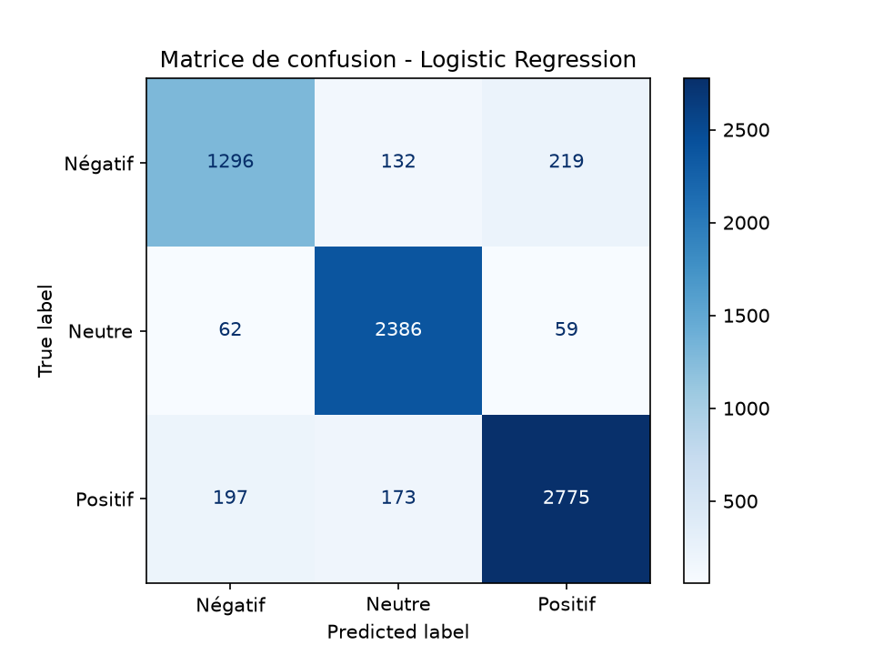

# Analyse de sentiment des commentaires YouTube

**TP3 : Projet ML complet, du développement au déploiement cloud**  
ENSAM Rabat — Université Mohammed V  
Filière INDIA — 2026/2027  
Prof. Maria Zemzami

**Réalisé par : GHANNAM Yousra

---

## 1. Présentation du projet

Ce projet consiste à développer un système d'analyse automatique du sentiment des commentaires YouTube.

L'application classe les commentaires en trois catégories :

- **Négatif (-1)**
- **Neutre (0)**
- **Positif (1)**

Le projet utilise un modèle de Machine Learning basé sur TF-IDF et la régression logistique. Une API FastAPI permet d'effectuer les prédictions, tandis qu'une extension Chrome récupère les commentaires visibles sur YouTube et affiche les résultats.

## 2. Architecture technique

```text
Utilisateur sur YouTube
        |
        v
Extension Chrome
        |
        | Extraction des commentaires
        v
API FastAPI
        |
        | POST /predict_batch
        v
Vectoriseur TF-IDF
        |
        v
Modèle de classification
(Logistic Regression)
        |
        v
Prédictions et statistiques
        |
        v
Affichage dans l'extension Chrome
```

### Technologies utilisées

| Composant | Technologie |
|:---|:---|
| Langage | Python |
| Prétraitement | Pandas, NumPy |
| Machine Learning | Scikit-learn |
| Vectorisation | TF-IDF |
| Modèle principal | Logistic Regression |
| API | FastAPI |
| Validation | Pydantic |
| Extension | HTML, CSS, JavaScript |
| Tests | Pytest |
| Conteneurisation | Docker |
| Versioning | Git et GitHub |

## 3. Structure du dépôt

```text
youtube-sentiment/
│
├── app_api.py
├── Dockerfile
├── .dockerignore
├── .gitignore
├── requirements.txt
├── requirements.prod.txt
├── pytest.ini
│
├── data/
│   ├── raw/
│   └── processed/
│
├── models/
│   ├── model.joblib
│   └── vectorizer.joblib
│
├── src/
│   ├── data/
│   │   ├── download_data.py
│   │   ├── preprocess.py
│   │   └── eda.py
│   │
│   ├── models/
│   │   └── train.py
│   │
│   └── api/
│       ├── main.py
│       └── schemas.py
│
├── chrome-extension/
│   ├── manifest.json
│   ├── content.js
│   ├── popup.html
│   ├── popup.css
│   └── popup.js
│
├── tests/
│   ├── test_api.py
│   └── test_model.py
│
├── reports/
│
└── README.md
```

## 4. Données et prétraitement

Le projet utilise le dataset Reddit Sentiment Analysis.

Les étiquettes sont :

| Valeur | Sentiment |
|:---:|:---|
| -1 | Négatif |
| 0 | Neutre |
| 1 | Positif |

Les principales étapes du prétraitement sont :

- Conversion des textes en minuscules.
- Suppression des URLs.
- Suppression des mentions.
- Nettoyage des caractères spéciaux.
- Suppression des textes vides.
- Suppression des doublons.

La séparation des données utilise un découpage stratifié de 80 % pour l'entraînement et 20 % pour le test, avec `random_state=42`.

## 5. Entraînement et évaluation du modèle

### 5.1 Vectorisation TF-IDF

La vectorisation transforme les commentaires textuels en caractéristiques numériques.

Paramètres utilisés :

| Paramètre | Valeur |
|:---|:---|
| Nombre maximal de caractéristiques | 50 000 |
| N-grammes | (1, 2) |
| min_df | 2 |
| sublinear_tf | True |

### 5.2 Comparaison des algorithmes

Trois algorithmes ont été comparés :

- Logistic Regression
- LinearSVC
- Random Forest

Les résultats obtenus sont :

| Algorithme | Accuracy | F1 macro |
|:---|---:|---:|
| Logistic Regression optimisée | **0,8846** | **0,8743** |
| LinearSVC | 0,8763 | 0,8643 |
| Random Forest | 0,7919 | 0,7576 |

La régression logistique optimisée obtient les meilleurs résultats globaux.

### 5.3 Optimisation des hyperparamètres

Une recherche GridSearchCV a été effectuée avec 3 folds de validation croisée.

Le meilleur paramètre obtenu est :

| Hyperparamètre | Meilleure valeur |
|:---|:---:|
| C | 50 |

### 5.4 Rapport de classification

Résultats obtenus sur le jeu de test :

| Classe | Précision | Rappel | F1-score | Support |
|:---|---:|---:|---:|---:|
| Négatif (-1) | 0,833 | 0,787 | 0,809 | 1 647 |
| Neutre (0) | 0,887 | 0,952 | 0,918 | 2 507 |
| Positif (1) | 0,909 | 0,882 | 0,895 | 3 145 |
| **Macro moyenne** | **0,876** | **0,874** | **0,874** | **7 299** |
| **Moyenne pondérée** | **0,884** | **0,885** | **0,884** | **7 299** |

### 5.5 Résumé des performances

| Critère | Objectif du TP | Résultat obtenu |
|:---|:---:|---:|
| Accuracy | ≥ 80 % | **88,46 %** |
| F1-score par classe | > 0,75 | **0,809 à 0,918** |
| Inférence sur 50 commentaires | < 100 ms | **10,6 ms en moyenne** |

Le modèle satisfait les objectifs de performance indiqués dans le TP.

### 5.6 Matrice de confusion



## 6. Sauvegarde du modèle

Après l'entraînement, le modèle et le vectoriseur sont sauvegardés dans le dossier `models/`.

| Fichier | Description |
|:---|:---|
| `model.joblib` | Modèle de classification entraîné |
| `vectorizer.joblib` | Vectoriseur TF-IDF entraîné |

Ces fichiers sont utilisés par l'API pour effectuer les prédictions sans réentraîner le modèle à chaque lancement.

## 7. Installation et exécution en local

### Prérequis

- Python 3.10 ou supérieur
- Git
- Google Chrome

### Cloner le dépôt

```bash
git clone https://github.com/TON-PSEUDO/youtube-sentiment.git
cd youtube-sentiment
```

### Créer l'environnement virtuel

Sous Windows PowerShell :

```powershell
python -m venv venv
venv\Scripts\activate
```

### Installer les dépendances

```bash
pip install -r requirements.txt
```

### Lancer l'API

```bash
python -m uvicorn app_api:app --host 0.0.0.0 --port 7860
```

Documentation interactive :

```text
http://localhost:7860/docs
```

## 8. API FastAPI

L'API expose deux endpoints principaux.

### GET /health

Permet de vérifier l'état de l'API et le chargement du modèle.

Exemple :

```json
{
  "status": "ok",
  "model_loaded": true
}
```

### POST /predict_batch

Permet d'analyser un ensemble de commentaires.

Exemple de requête :

```json
{
  "comments": [
    "I love this video",
    "This is terrible",
    "The video is okay"
  ]
}
```

L'API retourne les prédictions, les sentiments, les niveaux de confiance et les statistiques globales.

## 9. Extension Chrome

L'extension Chrome permet d'analyser les commentaires directement depuis une page YouTube.

### Fonctionnalités

- Extraction des commentaires visibles.
- Analyse automatique des sentiments.
- Affichage des statistiques globales.
- Affichage du sentiment et de la confiance pour chaque commentaire.
- Filtrage par sentiment.
- Mode sombre et mode clair.
- Copie des résultats.

### Installation

1. Ouvrir Google Chrome.
2. Accéder à `chrome://extensions`.
3. Activer le mode développeur.
4. Cliquer sur « Charger l'extension non empaquetée ».
5. Sélectionner le dossier `chrome-extension/`.
6. Vérifier que l'URL de l'API dans `popup.js` correspond à l'adresse du serveur.

### Captures d'écran

**Résultats de l'analyse :**


**Mode sombre :**


## 10. Déploiement avec Docker et GitHub Codespaces

Le projet utilise Docker pour conteneuriser l'API.

### Construire l'image Docker

```bash
docker build -t youtube-sentiment-api .
```

### Lancer le conteneur

```bash
docker run -d -p 7860:7860 youtube-sentiment-api
```

### Vérifier l'API

```bash
curl http://localhost:7860/health
```

Dans GitHub Codespaces, le port 7860 doit être rendu public pour permettre à l'extension Chrome de communiquer avec l'API.

L'URL publique doit ensuite être configurée dans `chrome-extension/popup.js`.

## 11. Tests et validation

Les tests automatisés sont réalisés avec Pytest.

Commande :

```bash
python -m pytest -v
```

Résultat obtenu :

```text
19 passed in 6.14s
```

Les tests couvrent notamment :

- Le fonctionnement de l'API.
- La route `/health`.
- Les prédictions par batch.
- Les données invalides.
- Les batches vides.
- Les cas limites.
- Les performances du modèle.
- Le temps d'inférence.

## 12. Limites et perspectives

### Limites

- Le modèle est entraîné sur des commentaires Reddit en anglais.
- Les commentaires en français et en arabe peuvent être moins bien classés.
- L'ironie et le sarcasme restent difficiles à détecter.
- L'extension analyse les commentaires déjà chargés sur la page YouTube.

### Améliorations possibles

- Utiliser un dataset de commentaires YouTube.
- Tester des modèles multilingues.
- Améliorer la détection de l'ironie et du sarcasme.
- Ajouter le chargement automatique de commentaires.
- Déployer l'API sur une plateforme d'hébergement permanent.

---

## Conclusion

Ce projet met en œuvre une chaîne complète de Machine Learning, depuis le prétraitement des données jusqu'à l'intégration du modèle dans une API et une extension Chrome.

La régression logistique optimisée obtient une accuracy de 88,46 % et un F1-score macro de 0,8743 sur le jeu de test.

L'ensemble constitue une solution de classification automatique des sentiments intégrant des outils de développement, de test et de déploiement.