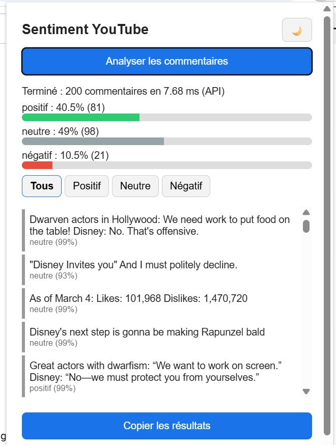
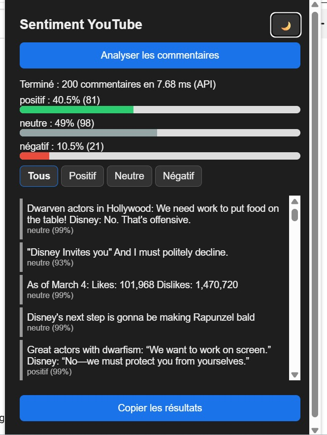

# Analyse de sentiment des commentaires YouTube
## TP3 : Projet ML complet, du développement au déploiement cloud

**ENSAM Rabat — Université Mohammed V**  
**Filière INDIA — 2026/2027**  
**Prof. Maria Zemzami**

**Réalisé par : GHANNAM Yousra**

---

## 1. Présentation du projet

Ce projet consiste à développer un système d'analyse automatique du sentiment des commentaires YouTube.

L'application classe les commentaires en trois catégories :

- Négatif (-1)
- Neutre (0)
- Positif (1)

Le projet utilise un modèle de Machine Learning basé sur TF-IDF et la régression logistique. Une API FastAPI permet d'effectuer les prédictions, tandis qu'une extension Chrome récupère les commentaires visibles sur YouTube et affiche les résultats.

L'objectif est de réaliser une chaîne complète de Machine Learning, depuis la préparation des données jusqu'au déploiement de l'API dans un environnement cloud avec Docker et GitHub Codespaces.

## 2. Architecture technique

```text
Utilisateur sur YouTube
        |
        v
Extension Chrome
        |
        | Extraction des commentaires
        v
API FastAPI
        |
        | POST /predict_batch
        v
Vectoriseur TF-IDF
        |
        v
Modèle de classification
(Logistic Regression)
        |
        v
Prédictions et statistiques
        |
        v
Affichage dans l'extension Chrome
```

### Technologies utilisées

| Composant | Technologie |
|---|---|
| Langage | Python |
| Prétraitement | Pandas, NumPy |
| Machine Learning | Scikit-learn |
| Vectorisation | TF-IDF |
| Modèle principal | Logistic Regression |
| API | FastAPI |
| Validation | Pydantic |
| Extension | HTML, CSS, JavaScript |
| Tests | Pytest |
| Conteneurisation | Docker |
| Environnement cloud | GitHub Codespaces |
| Versioning | Git et GitHub |

## 3. Structure du dépôt

```text
youtube-sentiment/
│
├── app_api.py
├── Dockerfile
├── .dockerignore
├── .gitignore
├── requirements.txt
├── requirements.prod.txt
├── pytest.ini
│
├── data/
│   ├── raw/
│   └── processed/
│
├── models/
│   ├── model.joblib
│   └── vectorizer.joblib
│
├── src/
│   ├── data/
│   │   ├── download_data.py
│   │   ├── preprocess.py
│   │   └── eda.py
│   │
│   ├── models/
│   │   └── train.py
│   │
│   └── api/
│       ├── main.py
│       └── schemas.py
│
├── chrome-extension/
│   ├── manifest.json
│   ├── content.js
│   ├── popup.html
│   ├── popup.css
│   └── popup.js
│
├── tests/
│   ├── test_api.py
│   └── test_model.py
│
├── reports/
│
└── README.md
```

**Remarque concernant les données :**

Les dossiers `data/raw/` et `data/processed/` sont utilisés localement pour stocker les données brutes et prétraitées. Les fichiers CSV ne sont pas inclus dans le dépôt GitHub afin d'éviter de versionner des fichiers de données volumineux. Ils sont exclus par le fichier `.gitignore`.

Les modèles entraînés `model.joblib` et `vectorizer.joblib` sont conservés dans le dépôt afin de permettre à l'API de réaliser les prédictions sans réentraînement.

## 4. Données et prétraitement

Le projet utilise le dataset Reddit Sentiment Analysis.

Les étiquettes sont :

| Valeur | Sentiment |
|---|---|
| -1 | Négatif |
| 0 | Neutre |
| 1 | Positif |

Les principales étapes du prétraitement sont :

- Conversion des textes en minuscules.
- Suppression des URLs.
- Suppression des mentions.
- Nettoyage des caractères spéciaux.
- Suppression des textes vides.
- Suppression des doublons.

La séparation des données utilise un découpage stratifié de 80 % pour l'entraînement et 20 % pour le test, avec `random_state=42`.

## 5. Entraînement et évaluation du modèle

### 5.1 Vectorisation TF-IDF

La vectorisation transforme les commentaires textuels en caractéristiques numériques.

Paramètres utilisés :

| Paramètre | Valeur |
|---|---|
| Nombre maximal de caractéristiques | 50 000 |
| N-grammes | (1, 2) |
| min_df | 2 |
| sublinear_tf | True |

### 5.2 Comparaison des algorithmes

Trois algorithmes ont été comparés :

- Logistic Regression
- LinearSVC
- Random Forest

Les résultats obtenus sont :

| Algorithme | Accuracy | F1 macro |
|---|---:|---:|
| Logistic Regression optimisée | 0,8846 | 0,8743 |
| LinearSVC | 0,8763 | 0,8643 |
| Random Forest | 0,7919 | 0,7576 |

La régression logistique optimisée obtient les meilleurs résultats globaux.

### 5.3 Optimisation des hyperparamètres

Une recherche GridSearchCV a été effectuée avec 3 folds de validation croisée.

Le meilleur paramètre obtenu est :

| Hyperparamètre | Meilleure valeur |
|---|---:|
| C | 50 |

### 5.4 Rapport de classification

Résultats obtenus sur le jeu de test :

| Classe | Précision | Rappel | F1-score | Support |
|---|---:|---:|---:|---:|
| Négatif (-1) | 0,833 | 0,787 | 0,809 | 1 647 |
| Neutre (0) | 0,887 | 0,952 | 0,918 | 2 507 |
| Positif (1) | 0,909 | 0,882 | 0,895 | 3 145 |
| Macro moyenne | 0,876 | 0,874 | 0,874 | 7 299 |
| Moyenne pondérée | 0,884 | 0,885 | 0,884 | 7 299 |

### 5.5 Résumé des performances

| Critère | Objectif du TP | Résultat obtenu |
|---|---:|---:|
| Accuracy | ≥ 80 % | 88,46 % |
| F1-score par classe | > 0,75 | 0,809 à 0,918 |
| Inférence sur 50 commentaires | < 100 ms | 10,6 ms en moyenne |

Le modèle satisfait les objectifs de performance indiqués dans le TP.

### 5.6 Matrice de confusion


La diagonale correspond aux prédictions correctes. La classe négative est la plus difficile (rappel 0,787), avec des confusions surtout avec la classe neutre.

## 6. Sauvegarde du modèle

Après l'entraînement, le modèle et le vectoriseur sont sauvegardés dans le dossier `models/`.

| Fichier | Description |
|---|---|
| `model.joblib` | Modèle de classification entraîné |
| `vectorizer.joblib` | Vectoriseur TF-IDF entraîné |

Ces fichiers sont utilisés par l'API pour effectuer les prédictions sans réentraîner le modèle à chaque lancement.

## 7. Installation et exécution en local

### Prérequis

- Python 3.10 ou supérieur
- Git
- Google Chrome

### Cloner le dépôt

```bash
git clone https://github.com/you940/youtube-sentiment.git
cd youtube-sentiment
```

### Créer l'environnement virtuel

Sous Windows PowerShell :

```powershell
python -m venv venv
venv\Scripts\activate
```

### Installer les dépendances

```bash
pip install -r requirements.txt
```

### Lancer l'API

```bash
python -m uvicorn app_api:app --host 0.0.0.0 --port 7860
```

**Documentation interactive :**

http://localhost:7860/docs

**Vérification de l'état de l'API :**

http://localhost:7860/health

## 8. API FastAPI

L'API expose les endpoints principaux suivants.

### GET /health

Permet de vérifier l'état de l'API et le chargement du modèle.

Exemple de réponse :

```json
{
  "status": "ok",
  "model_loaded": true
}
```

### POST /predict_batch

Permet d'analyser un ensemble de commentaires.

Exemple de requête :

```json
{
  "comments": [
    "I love this video",
    "This is terrible",
    "The video is okay"
  ]
}
```

L'API retourne les prédictions, les sentiments, les niveaux de confiance et les statistiques globales.

### Documentation interactive

FastAPI fournit une documentation interactive accessible à l'adresse :

`/docs`

Elle permet de consulter les endpoints et de tester les requêtes directement depuis le navigateur.

## 9. Extension Chrome

L'extension Chrome permet d'analyser les commentaires directement depuis une page YouTube.

### Fonctionnalités

- Extraction des commentaires visibles.
- Analyse automatique des sentiments.
- Affichage des statistiques globales.
- Affichage du sentiment et de la confiance pour chaque commentaire.
- Filtrage par sentiment.
- Mode sombre et mode clair.
- Copie des résultats.

### Installation

1. Ouvrir Google Chrome.
2. Accéder à `chrome://extensions/`.
3. Activer le mode développeur.
4. Cliquer sur « Charger l'extension non empaquetée ».
5. Sélectionner le dossier `chrome-extension/`.
6. Vérifier que la constante `API_URL` dans `popup.js` correspond à l'adresse du serveur FastAPI.

### Configuration de l'adresse de l'API

Pour une exécution locale :

```javascript
const API_URL = "http://localhost:7860";
```

Pour une exécution dans GitHub Codespaces :

```javascript
const API_URL = "https://improved-space-xylophone-5g5pxqr755r5h4gwx-7860.app.github.dev";
```

L'adresse doit être celle du port 7860, sans ajouter `/docs`, `/health` ou `/predict_batch`.

L'extension utilise ensuite l'endpoint `/predict_batch` pour envoyer les commentaires à l'API.

Après toute modification de `popup.js`, il faut enregistrer le fichier, actualiser l'extension depuis `chrome://extensions/` et recharger la page YouTube.

## 10. Déploiement avec Docker dans GitHub Codespaces

Le projet utilise Docker pour conteneuriser l'API FastAPI et GitHub Codespaces pour exécuter le conteneur dans un environnement cloud.

### 10.1. Construction de l'image Docker

Depuis le terminal de GitHub Codespaces, à la racine du projet :

```bash
docker build -t youtube-sentiment-api .
```

Cette commande construit l'image Docker à partir du Dockerfile.

### 10.2. Lancement du conteneur

```bash
docker run -d --name youtube-sentiment-container -p 7860:7860 youtube-sentiment-api
```

Vérifier que le conteneur fonctionne :

```bash
docker ps
```

Le conteneur doit apparaître avec le statut `Up` et le port 7860 associé.

### 10.3. Configuration du port public

Dans l'interface GitHub Codespaces :

1. Ouvrir l'onglet **PORTS**.
2. Repérer le port 7860.
3. Ouvrir le menu **Port Visibility**.
4. Sélectionner **Public**.
5. Copier l'adresse HTTPS publique générée par Codespaces.

Cette configuration permet d'accéder à l'API depuis l'extérieur du Codespace.

### 10.4. Vérification du déploiement

Les endpoints suivants permettent de vérifier le fonctionnement de l'API :

**Vérification de l'état :**

https://improved-space-xylophone-5g5pxqr755r5h4gwx-7860.app.github.dev/health

**Documentation interactive :**

https://improved-space-xylophone-5g5pxqr755r5h4gwx-7860.app.github.dev/docs

**Prédiction par batch :**

`POST https://improved-space-xylophone-5g5pxqr755r5h4gwx-7860.app.github.dev/predict_batch`

Pour tester la prédiction, utiliser la documentation Swagger (`/docs`) avec une requête POST et un exemple de commentaires.

L'endpoint `/health` doit retourner une réponse indiquant que l'API fonctionne et que le modèle est chargé.

Exemple :

```json
{
  "status": "ok",
  "model_loaded": true
}
```

La documentation Swagger est accessible avec `/docs`.

### 10.5. Connexion de l'extension Chrome

Dans `chrome-extension/popup.js`, configurer `API_URL` avec l'adresse HTTPS publique du port 7860 :

```javascript
const API_URL = "https://improved-space-xylophone-5g5pxqr755r5h4gwx-7860.app.github.dev";
```

L'extension communique alors avec l'API exécutée dans le conteneur Docker sur GitHub Codespaces.

**Remarque :** l'API est accessible publiquement lorsque le Codespace est actif et que le port 7860 est configuré en Public. L'adresse peut devenir inaccessible lorsque le Codespace est arrêté ou suspendu. Il faut alors redémarrer le Codespace et relancer le conteneur si nécessaire.

## 11. Tests et validation

Les tests automatisés sont réalisés avec Pytest.

Commande :

```bash
python -m pytest -v
```

Résultat obtenu :

```text
19 passed in 6.14s
```

Les tests couvrent notamment :

- Le fonctionnement de l'API.
- La route `/health`.
- Les prédictions par batch.
- Les données invalides.
- Les batches vides.
- Les cas limites.
- Les performances du modèle.
- Le temps d'inférence.

## 12. Démonstration

### Extension Chrome : analyse du trailer *Snow White*

**Mode clair**



**Mode sombre**



## 13. Limites et perspectives

### Limites

- Le modèle est entraîné sur des commentaires Reddit en anglais.
- Les commentaires en français et en arabe peuvent être moins bien classés.
- L'ironie et le sarcasme restent difficiles à détecter.
- Sur le trailer *Snow White* (200 commentaires), le modèle donne 39,5 % de positif, 48,5 % de neutre et 12 % de négatif, alors que la plupart des commentaires sont sarcastiques et critiques : le sarcasme est souvent classé « neutre » ou « positif ».
- L'extension analyse les commentaires déjà chargés sur la page YouTube.
- Le déploiement Codespaces dépend de l'activité du Codespace.

### Améliorations possibles

- Utiliser un dataset de commentaires YouTube.
- Tester des modèles multilingues.
- Améliorer la détection de l'ironie et du sarcasme.
- Ajouter le chargement automatique de commentaires.
- Déployer l'API sur une plateforme d'hébergement permanent.

## Conclusion

Ce projet met en œuvre une chaîne complète de Machine Learning, depuis le prétraitement des données jusqu'à l'intégration du modèle dans une API FastAPI et une extension Chrome.

La régression logistique optimisée obtient une accuracy de 88,46 % et un F1-score macro de 0,8743 sur le jeu de test.

Le projet comprend également une API conteneurisée avec Docker et exécutée dans GitHub Codespaces, avec un accès public via le port 7860.

L'ensemble constitue une solution de classification automatique des sentiments intégrant des outils de développement, de test, de conteneurisation et de déploiement cloud.